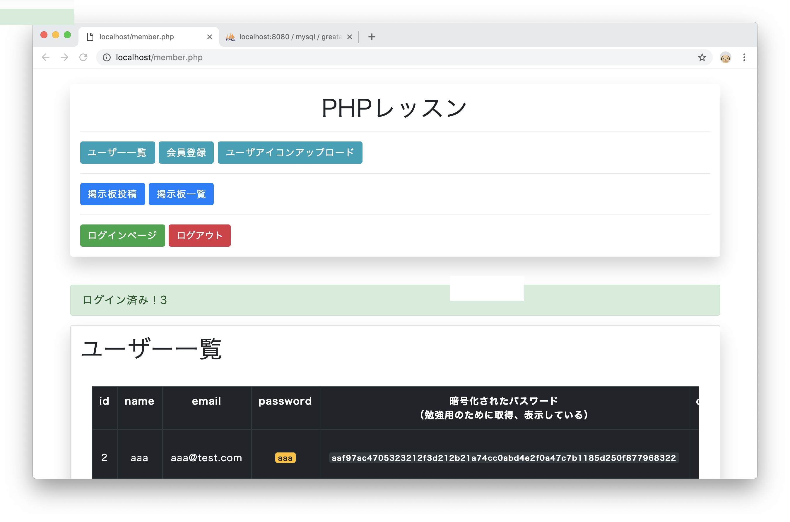
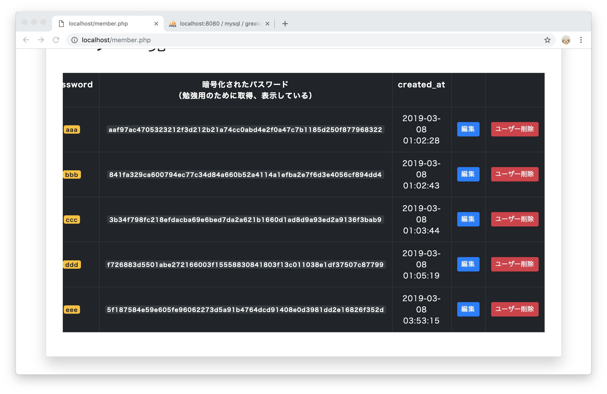
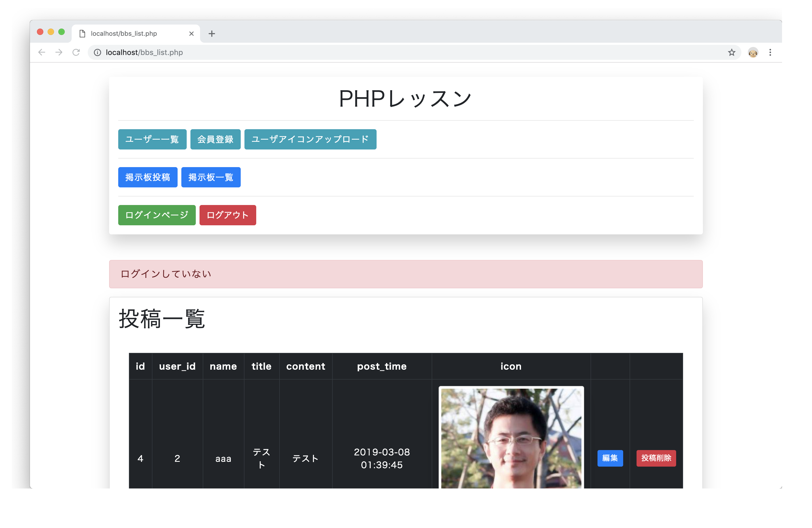
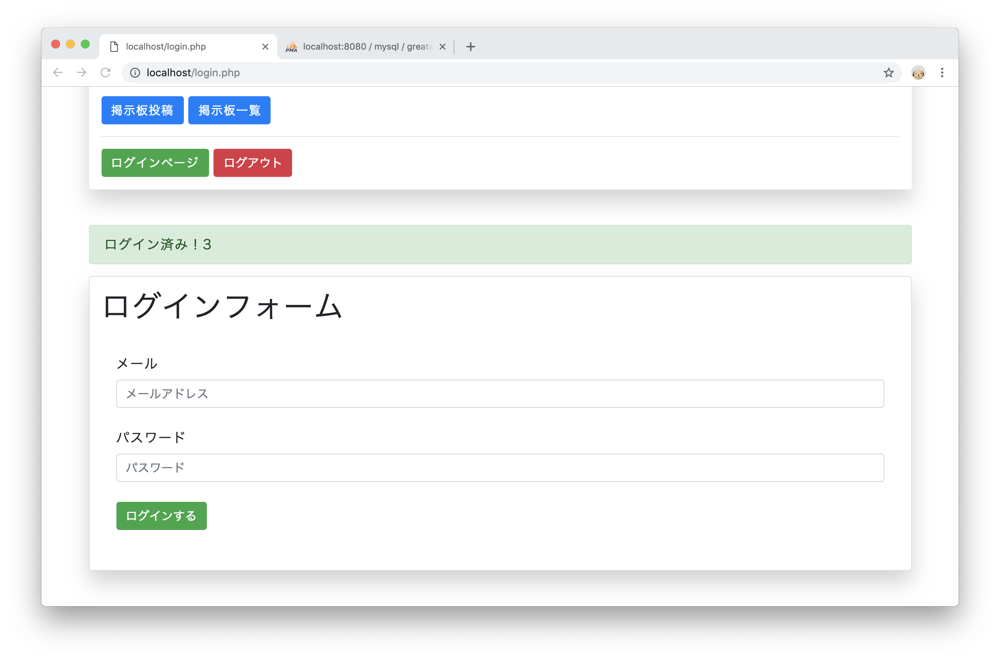
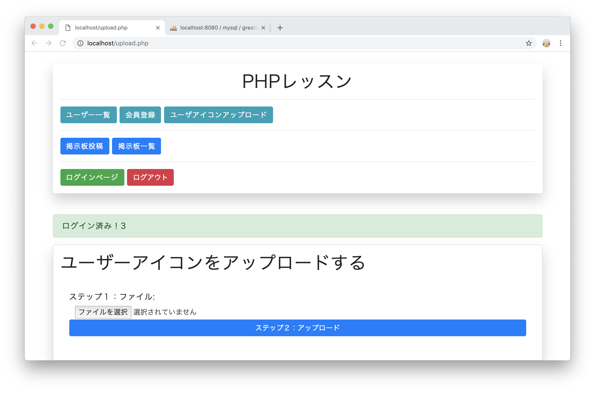
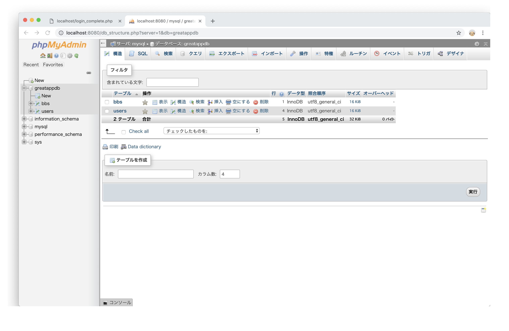

# 目的

PHP初心者の勉強用

記事：https://kokensha.xyz/web/php-lesson-sample-code-at-github/

Laravelなどのフレームワークは使用せず、基礎の勉強を意識して、PHPの基本を理解するのが目的です。

PHPを教える人、PHPを勉強する人みんなの参考になる、分かりやすいPHPのアプリケーションのサンプルコードになればと思います。

MITライセンスなので、自由にForkして、自由に使ってください。

Pull Requestが大歓迎です。


スクリーンショット













# 使い方

Dockerが必要です。


## STEP 1

```bash
git clone [this depository]
cd [this depository]/
```

## STEP 2 設定ファイルを用意する

`.env.example` を `.env` にコピーして、自分の値を設定してください。

```bash
cp .env.example .env
```

`.env` に設定が必要な項目は2つです。

| 変数 | 内容 |
| --- | --- |
| `MYSQL_ROOT_PASSWORD` | MySQLのrootパスワード。任意の値 |
| `APP_PASSWORD_SALT_SECRET` | パスワードのsalt用シークレット。長いランダム文字列 |

`.env` は `.gitignore` に入っているので、コミットされません。

## STEP 3

```bash
docker-compose up
```

ブラウザで http://localhost にアクセスしてください。

# データベース

初回起動時に `mysql/init/01-schema.sql` が自動実行され、`greatappdb` と
`users` / `bbs` テーブルが作成されます。データは名前付きボリューム `db` に保存されるため、
リポジトリには入りません。

localhost:8080 から phpmyadmin が使えます。

phpmyadminからデータベースやテーブルの詳細を確認できます。

データを作り直したいときは、ボリュームごと削除してから起動してください。

```bash
docker-compose down -v
docker-compose up
```

# サポート

いつでもお気軽に、Pull Requestどうぞ！

勉強用の内容ですので、本番環境は使えません。

# 学習サポート

内容の学習にサポートが必要な場合は、川島のITスキルサロンの参加をぜひご検討ください。

https://note.com/kawashimaken/m/me13f2d6e0ab8


